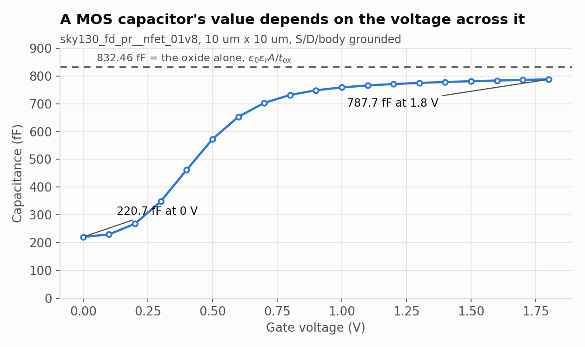

# Capacitors on a chip

There is no ceramic disc on a chip, so what is a capacitor made of?

At bottom, a capacitor is **two conductors that are near each other but not touching**. The
dielectric, the plates and the packaging are engineering built around that.

Put two flat plates of area $A$ a distance $d$ apart, with a material of relative permittivity
$\varepsilon_r$ between them:

$$C = \varepsilon_0 \varepsilon_r \frac{A}{d}$$

You know this formula already. What changes on a chip is that you can't choose $d$, because the
foundry has already fixed the thickness of every layer. That leaves $A$, the area you're willing
to spend, as the only thing you can vary. So on a chip, capacitance is quoted in **farads per
square micrometre**, and the design question is always how much floor space you're buying.

## The three kinds of capacitor in SKY130

**MIM (metal–insulator–metal).** A dedicated thin plate (`capm`) sits just above met3, with a
thin dielectric made for the purpose between the two. That plate has no other job than making
capacitors. The models are `sky130_fd_pr__cap_mim_m3_1` (between met3 and met4)
and `..._m3_2` (met4 to met5).

**MOS (a transistor used as a capacitor).** Take an nFET, tie source, drain and body to ground,
and use the gate as one plate against the channel underneath. The dielectric is the gate oxide,
the thinnest insulator on the chip, so this is by far the densest capacitor available.

**VPP (vertical parallel plate).** A VPP needs no special layer at all. Ordinary metal wires are
interleaved like the teeth of two combs, and the capacitance between their sidewalls does the
work. SKY130 ships about eighty pre-drawn VPP structures, named by their footprint:
`sky130_fd_pr__cap_vpp_11p5x11p7_l1m1m2m3m4_shieldm5` is 11.5 µm × 11.7 µm and uses li plus
met1 through met4, shielded by met5.

## Measured capacitance of each type

`labs/passives-decks/spice/c_area.spice` puts a 1 V AC source at 1 kHz across each device and
reads the current it draws, so $C = \operatorname{Im}(I)/2\pi f$. Nothing is fitted to the
result, so each number is exactly what the model produces. The deck prints:

```
--- capacitance in farads ---
c_mim_1x1 = 2.642250e-15
c_mim_10x10 = 2.065822e-13
c_mim_30x30 = 1.819782e-12
c_vpp = 1.473400e-13
c_mos_1v8 = 7.876883e-13
c_mos_0v0 = 2.207182e-13
```

| construction | drawn size | capacitance | density |
|---|---|---:|---:|
| MIM | 1 × 1 µm | 2.64225 fF | 2.64 fF/µm² |
| MIM | 10 × 10 µm | 206.5822 fF | 2.07 fF/µm² |
| MIM | 30 × 30 µm | 1819.782 fF | 2.02 fF/µm² |
| VPP fringe | 11.5 × 11.7 µm | 147.3400 fF | 1.10 fF/µm² |
| MOS at 1.8 V | 10 × 10 µm gate | 787.6883 fF | 7.88 fF/µm² |
| MOS at 0 V | the same device | 220.7182 fF | 2.21 fF/µm² |

You'll run this deck in
[Lab 02, Part 5](../labs/lab-02-how-big-is-a-picofarad-overview.md#part-5-the-mos-capacitors-cv-curve).
Two things in that table need explaining: the MIM density, which isn't the same at every size,
and the MOS capacitor, whose value changes with voltage.

## The MIM arithmetic

You can reproduce the MIM model's numbers by hand, to the last digit. Its parameter file
(`libs.tech/ngspice/r+c/res_typical__cap_typical__lin.spice`) says

```
+ camimc=  2.00e-15  ; Units: farad/micrometer^2
+ cpmimc = 0.19e-15 ; Units: farad/micrometer
```

That's 2.00 fF for every square micron of plate, plus 0.19 fF for every micron of plate
*perimeter*, which comes from the field that bulges out at the edges. The model card also
corrects the drawn size:

```
.param wc = 'w+m3_dw*1e6+tol_m3*1e6'
```

with `m3_dw = -0.025u`, so a plate you drew 30 µm across is manufactured 29.975 µm across. For
the 30 × 30 device:

$$2.00 \times 29.975^2 \;+\; 0.19 \times 2 \times (29.975 + 29.975) = 1797.00125 + 22.781 = \boxed{1819.782\ \text{fF}}$$

ngspice printed `1.819782e-12`, which matches every digit.

The perimeter term also explains the density column: 2.64 fF/µm² for the 1 × 1 device, falling
to 2.02 fF/µm² at 30 × 30. **Small capacitors are denser than big ones**, because the edge makes
up a larger fraction of a small plate. It's the same kind of effect as the contact heads on a
short resistor, and you'll see it again.

## MOS capacitance and gate voltage

Look again at the last two rows of the table. They're the same transistor with the same 100 µm²
of gate, yet it measures 787.6883 fF with 1.8 V on the gate and 220.7182 fF with 0 V. That's a
factor of 3.57, which is a lot for a component whose whole job is to have a value.

`spice/c_moscap_cv.spice` sweeps the gate from 0 V to 1.8 V in 100 mV steps:



The curve starts at 220.7182 fF at 0 V, climbs steeply between 0.3 V and 0.7 V, and flattens
toward 787.6883 fF without quite reaching the dashed line.

The steep part is the threshold. Below it, the gate faces a depleted, nearly empty channel, so it
behaves like two plates far apart. Above it, an inversion layer forms right under the oxide,
so the second "plate" is now only a few nanometres away. What you're looking at is a MOSFET
turning on, seen from the capacitance side, and you'll meet this capacitance again in AD103 as
what sets a transistor's speed.

The dashed line is worked out from the oxide thickness rather than fitted to the curve, and the
nFET model card (`sky130_fd_pr__nfet_01v8__tt.pm3.spice`) gives that thickness:

```
+ toxe = {4.148e-09 + ...}
```

That is 4.148 nm, so the oxide capacitance per unit area is

$$C_{ox} = \frac{\varepsilon_0 \varepsilon_r}{t_{ox}} = \frac{8.854\times10^{-12} \times 3.9}{4.148\times10^{-9}} = 8.3247\ \text{fF/µm}^2$$

and over 100 µm² of gate that comes to 832.46 fF. The simulation tops out at 787.6883 fF, which
is 94.6 % of it. The missing 5 % is the inversion layer's own finite capacitance, which sits in
series with the oxide. That's close enough that you can use $C_{ox} A$ as a back-of-envelope
estimate for a MOS capacitor and be within 6 %.

## Choosing between them

| | MIM | MOS | VPP |
|---|---|---|---|
| density | 2.0 fF/µm² | ~8 fF/µm² | ~1.1 fF/µm² |
| linear? | **yes** | no: 3.57× swing | yes |
| leaks? | no | yes, through 4 nm of oxide | no |
| needs extra masks? | yes | no | **no** |
| sits above the transistors? | yes | no | yes |

Use **MIM** when the capacitance has to stay at the value you designed: in filters, references,
and anything else where "3.57× depending on the signal" would break the circuit. Use **MOS** when
you need a lot of farads and don't care about linearity. Supply decoupling is the classic case,
because there the capacitor's whole job is to be a charge reservoir at a fixed voltage. Use
**VPP** when you want a capacitor without paying for the MIM masks, or when you want a ratio rather than a value, since fringe structures
match well.

The word "capacitor" covers three different devices here, each with its own way of failing.
If you pick the wrong one, you can end up with a filter whose corner frequency depends on the
input signal, and that kind of bug doesn't show up until the chip is built.

Next: [What a picofarad costs](../guide/what-a-picofarad-costs.md), where the density column turns
into floor plan.
