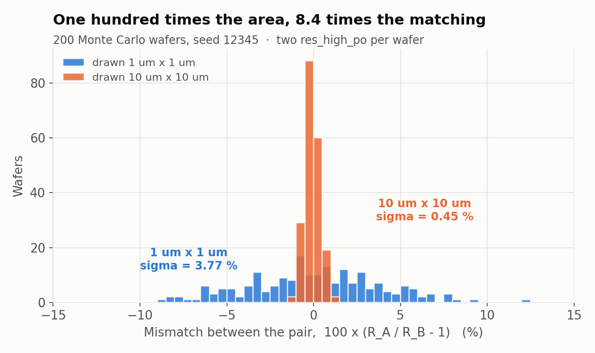

# Matching and Pelgrom's law

If a chip cannot hold a resistor to better than ±12.5 %, how does anyone build a 12-bit
converter? By never asking the chip for a value, only for a **ratio**.

This is the most important idea in analog IC design. It is one line of arithmetic, and it is
rarely taught in a first circuits course, which is a shame, because it explains most of what
analog schematics look like.

## Ratios across corners

The corners deck from [Process corners](guide/the-value-you-drew-is-not-what-you-get.md) also
prints, for each corner, two resistors drawn 1:4 and the output of a divider made from them:

```
--- ll : absolute (moves) ---
r_a = 3.106637e+03
r_b = 1.143366e+04
--- ll : ratio and divider (do not move) ---
ratio = 3.680396e+00
divider = 3.845828e-01
```
```
--- tt : absolute (moves) ---
r_a = 3.550443e+03
r_b = 1.306704e+04
--- tt : ratio and divider (do not move) ---
ratio = 3.680396e+00
divider = 3.845828e-01
```
```
--- hh : absolute (moves) ---
r_a = 3.994248e+03
r_b = 1.470042e+04
--- hh : ratio and divider (do not move) ---
ratio = 3.680396e+00
divider = 3.845828e-01
```

In one table:

| | `ll` | `tt` | `hh` | spread |
|---|---:|---:|---:|---:|
| $R_A$ | 3106.637 Ω | 3550.443 Ω | 3994.248 Ω | **±12.5 %** |
| $R_B$ | 11 433.66 Ω | 13 067.04 Ω | 14 700.42 Ω | **±12.5 %** |
| $R_B / R_A$ | 3.680396 | 3.680396 | 3.680396 | **0** |
| divider out | 0.3845828 V | 0.3845828 V | 0.3845828 V | **0** |

Every printed digit of the ratio and of the divider output is identical. The two resistors swung
by a quarter of their value between those runs, and the circuit built from them did not move at
all. You'll run this in
[Lab 04, Part 1](labs/lab-04-two-resistors-that-disagree-overview.md#part-1-process-corners).

## Why the ratio holds

A corner does not add an offset; it applies a **multiplier**. Every device made of that material
gets the same factor $k$:

$$\frac{R_B}{R_A} = \frac{k\,R_{\square}\,L_B/W}{k\,R_{\square}\,L_A/W} = \frac{L_B}{L_A}$$

$k$ cancels, and so does $R_\square$. So does the width tolerance, if both resistors are the same
width. What is left is a ratio of lengths you drew, and lengths on a mask are held to
nanometres.

That also explains why the ratio is 3.680396 rather than the 4.0 you drew. $L_B/L_A = 40/10 = 4$
for the *bodies*, but each device also carries 378.2448 Ω of ends
([Ohms per square](guide/ohms-per-square.md)):

$$\frac{R_B}{R_A} = \frac{378.2448 + 317.2198\times 40}{378.2448 + 317.2198\times 10} = \frac{13067.04}{3550.443} = 3.680397$$

ngspice printed `3.680396`. The end resistance is a systematic ratio error, and it does not go
away with the corner. That is why real layouts build a 4:1 ratio as four identical unit
resistors in series next to one, not as one long strip beside one short one. Four units in series
have four sets of ends and one unit has one, so the ratio comes out 4.000000, at every corner.

That is the first rule of matched layout, and you can derive it from a printed number:

> **If you need a ratio, build both sides from the same unit device, repeated. Never from one big
> device and one small one.**

## Mismatch between identical devices

Corners are global, so ratios cancel them completely. Mismatch is local, and it does not cancel
at all; it sets the floor.

`labs/passives-decks/spice/mismatch.spice` runs two hundred Monte Carlo samples with
`mc_mm_switch=1` and `setseed 12345`, so the numbers are reproducible. ([Lab 04](labs/lab-04-two-resistors-that-disagree-overview.md)
runs a similar experiment from `setseed 1` and gets 2.5852 % for the 1 µm² device: a different
draw from the same distribution, not a different answer.) There are four devices: **A** and **B**
drawn 1 µm × 1 µm, and **C** and **D** drawn 10 µm × 10 µm, one hundred times the area, with the
same material and the same foundry.

```
== 5/5  mismatch: 200 wafers, four resistors ==================
   800 measurements recorded

  Monte Carlo: 200 runs, seed 12345
  ok       sigma/mean A (1x1)       2.7930 %   (reference  2.7930 %)
  ok       sigma/mean B (1x1)       2.8775 %   (reference  2.8775 %)
  ok       sigma/mean C (10x10)     0.3045 %   (reference  0.3045 %)
  ok       sigma/mean D (10x10)     0.3479 %   (reference  0.3479 %)
  ok       sigma/mean A/B ratio     3.7695 %   (reference  3.7695 %)
  ok       sigma/mean C/D ratio     0.4496 %   (reference  0.4496 %)
           100x the area bought 8.38x better matching   (Pelgrom's square root of 100 would be 10x)
```



That is two hundred wafers, each with two resistors drawn from the same rectangle. The blue
histogram is the 1 µm × 1 µm pair: routinely 5 % apart, sometimes 12 %. The orange is the
10 µm × 10 µm pair, almost all within half a percent.

## Pelgrom's law

The rule behind that plot is **Pelgrom's law**: the mismatch between two identically drawn
devices scales as one over the square root of their area.

$$\frac{\sigma_{\Delta R}}{R} = \frac{A_R}{\sqrt{W L}}$$

$A_R$ is a constant for each process, and SkyWater prints it on the model card, in
`sky130_fd_pr__res_high_po.model.spice`:

```
+ body_pelgrom = 0.03552
+ head_pelgrom = 0.0761
+ num_con_row = {max(floor(0.5+(w-0.33)/0.36),1)}
+ rbody_match = {body_pelgrom/sqrt(w*l*mult)*MC_MM_SWITCH*AGAUSS(0,1.0,1)}
+ rend_match  = {head_pelgrom/sqrt((w+0.525)*num_con_row*mult)*MC_MM_SWITCH*AGAUSS(0,1.0,1)}
```

The body matches as $0.03552/\sqrt{WL}$. The contact heads match as
$0.0761/\sqrt{(W+0.525)\,n_{\text{contacts}}}$, a different law, because a contact head is a row
of cuts rather than an area.

### Worked example: predicting the Monte Carlo

You can predict the Monte Carlo result before you look at it. The head and body of both devices
come from `make resistor` in `labs/passives-decks`:

```
head_l1 = 2.998915e+02    body_l1 = 3.955731e+02    r_l1 = 6.954646e+02
head_10x10 = 3.410354e+01 body_10x10 = 3.247625e+02 r_10x10 = 3.588661e+02
```

**The 1 µm × 1 µm device.** $n_{\text{contacts}} = \lfloor 0.5 + (1-0.33)/0.36 \rfloor = 2$.

$$\sigma_{\text{head}} = \frac{0.0761}{\sqrt{1.525 \times 2}} = 4.357\ \% \qquad \sigma_{\text{body}} = \frac{0.03552}{\sqrt{1}} = 3.552\ \%$$

$$\sigma_R = \sqrt{(299.8915 \times 0.04357)^2 + (395.5731 \times 0.03552)^2} = \sqrt{13.067^2 + 14.051^2} = 19.188\ \Omega$$

$$\frac{\sigma_R}{R} = \frac{19.188}{695.4646} = \boxed{2.759\ \%}$$

Monte Carlo says 2.7930 % and 2.8775 %. Two hundred samples pin σ down only to about
$1/\sqrt{2N} = 5\ \%$ of itself, so 2.759 and 2.79 are the same number.

**The 10 µm × 10 µm device.** $n_{\text{contacts}} = \lfloor 0.5 + 9.67/0.36 \rfloor = 27$.

$$\sigma_{\text{head}} = \frac{0.0761}{\sqrt{10.525 \times 27}} = 0.4514\ \% \qquad \sigma_{\text{body}} = \frac{0.03552}{\sqrt{100}} = 0.3552\ \%$$

$$\sigma_R = \sqrt{(34.10354 \times 0.004514)^2 + (324.7625 \times 0.003552)^2} = 1.1638\ \Omega$$

$$\frac{\sigma_R}{R} = \frac{1.1638}{358.8661} = \boxed{0.3243\ \%}$$

Monte Carlo says 0.3045 % and 0.3479 %.

The predicted improvement is $2.759 / 0.3243 = 8.51\times$, and the measured one is 8.38×.

It is not 10. Pelgrom's $\sqrt{100} = 10$ is what you get if the whole device is body, and it
isn't: 43 % of the small resistor is contact head, and heads match as $\sqrt{(W+0.525)\,n}$,
which improved by only 9.7× between the two devices where the body's $\sqrt{WL}$ improved 10×.
The shortfall from 10 to 8.4 comes from the contact heads. If you had predicted 10×, you would
have been wrong in a way the model can explain.

## Four rules of analog layout

All of the above turns into four practical rules:

1. **Build ratios from identical unit devices.** A 4:1 ratio is four units and one unit, never a
   long device and a short one. This removes the end-resistance error, and both sides see the
   same etch.
2. **Buy matching with area.** For 0.1 % matching, $\sigma = A_R/\sqrt{WL}$ gives
   $WL \approx (0.03552/0.001)^2 = 1262$ µm² per device. Matching is not free, and its price is
   in square micrometres.
3. **Surround the array with dummies.** The outermost real unit has a neighbour on one side and
   empty space on the other, and etch and stress respond to that difference. An extra unit
   connected to nothing makes every real unit's surroundings identical.
4. **Interdigitate, or use a common centroid.** The wafer has gradients across it, in temperature,
   oxide thickness and stress, so two devices placed side by side sit at different points on the
   gradient. Splitting each device into halves and laying them out `A B B A` puts both devices'
   centres at the same point, so a linear gradient cancels exactly.

Rules 3 and 4 are drawings, not equations, so they belong to
[AD104](https://uoftasic.com/ad104/). The reasons for them are on this page.

## How analog circuits use matching

Go back to the question at the top. A 12-bit ADC needs 1-part-in-4096 accuracy from a process
that cannot hold a resistor to one part in eight. It gets there because its accuracy never
depends on an absolute value:

- a **capacitor DAC** is a binary-weighted array of identical unit capacitors, so its linearity
  is a ratio, and the unit is made large enough that Pelgrom's law gives the required $\sigma$;
- a **current mirror** copies a current by making two transistors identical, without needing to
  know what the current is;
- a **bandgap reference** produces a voltage from a resistor ratio times $kT/q$, a physical
  constant, so the absolute sheet resistance drops out;
- a **differential pair**, the basic analog building block, only cares that its two halves are
  the same, not what they are.

These all use the same idea. Silicon is very good at making two things the same and poor at
making one thing a particular value, so analog circuits ask it for copies rather than numbers.

Next on the [Course path](README.md#course-path):
[Lab 04: Two resistors that disagree](labs/lab-04-two-resistors-that-disagree-overview.md). It
runs its own Monte Carlo, checks Pelgrom's law across four device sizes, and ends with a divider
specification that a naive two-resistor layout cannot meet. After that comes
[From schematic to cross-section](guide/from-schematic-to-cross-section.md), which turns the chip
on its side and takes your measured 317.2198 Ω/□ back to a material property.

Stuck on anything here? Ask in the [team Discord](https://discord.gg/hrJnP5UsGz).
