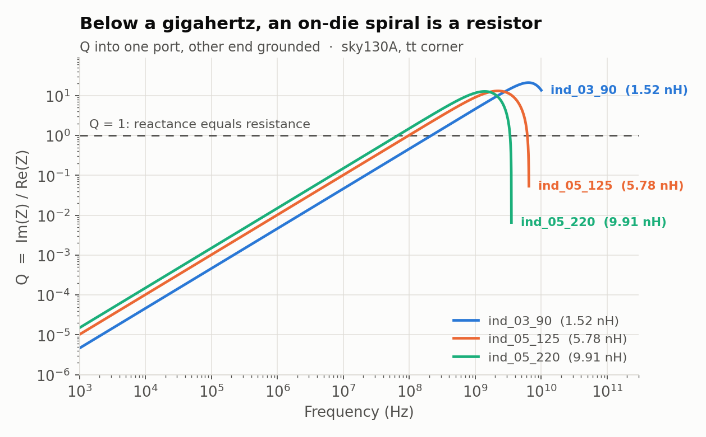
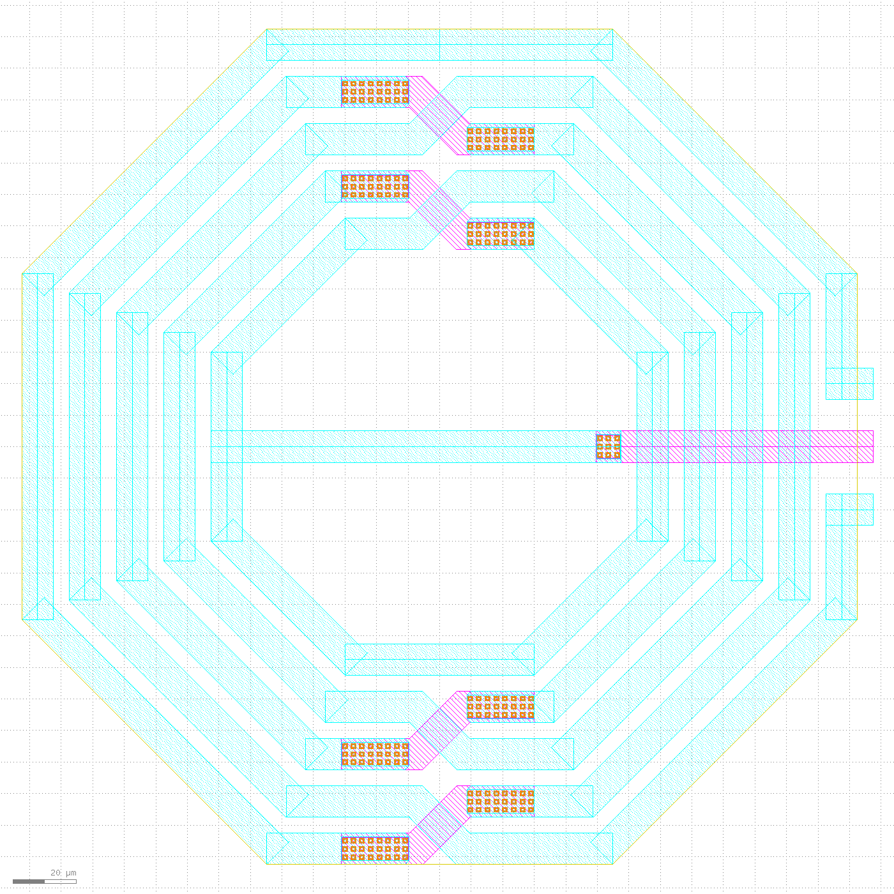
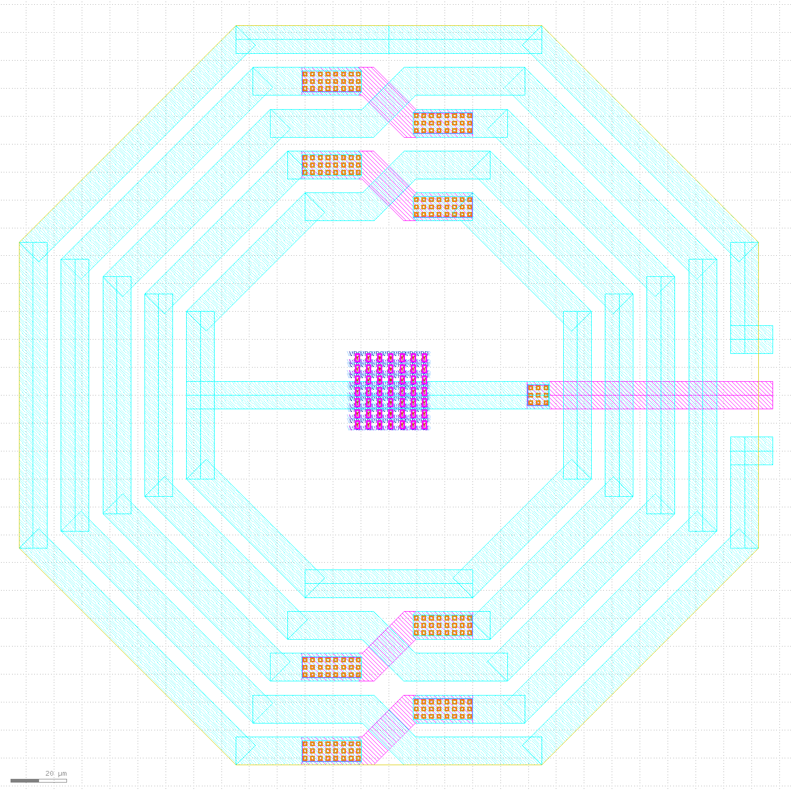

# Inductors on a chip

Resistors and capacitors both turned out to be drawings, so you might expect an inductor to be a
spiral you draw. It is, and that is the problem: it is both a poor inductor and an enormous one,
for the same underlying reason.

So far, every passive on a chip has been "a shape, and the shape costs area". Inductors break the
pattern. You can draw one, and the foundry will make it, but at most frequencies what you get
back behaves like a resistor.

## The three SKY130 inductor models

SKY130 models exactly three spiral inductors. They live in `libs.ref/sky130_fd_pr/spice/`, and
unlike everything else in this course they are **not** included by `sky130.lib.spice`; you have
to `.include` them yourself:

```
sky130_fd_pr__ind_03_90.model.spice
sky130_fd_pr__ind_05_125.model.spice
sky130_fd_pr__ind_05_220.model.spice
```

> **Warning:** if you forget the `.include`, ngspice says
>
> ```
> Error: unknown subckt: x1 a 0 ct 0 sky130_fd_pr__ind_05_220
>     Simulation interrupted due to error!
> Error: incomplete or empty netlist
> ```
>
> The PDK is not broken; you have left out a file.

`sky130_fd_pr__ind_05_220.model.spice` is thirteen lines long:

```
.subckt  sky130_fd_pr__ind_05_220 a b ct sub
R31 net27 b r='1e-2'
R26 a net23 r='1e-2'
C2 net27 net31 c='223.7e-15'
C24 net35 net27 c='205e-15'
C25 net23 net37 c='223.7e-15'
R5 sub net31 r='5.358e3'
R4 net41 net27 r='2.059'
R13 net23 net35 r='9.064'
R10 sub net37 r='5.358e3'
R9 net23 net39 r='2.059'
    L1 net39 ct l=4.96e-9
    L3 ct net41 l=4.96e-9
.ends
```

There are two inductors of 4.96 nH, one on either side of the centre tap `ct`, for **9.92 nH
total**. Around them are 4.138 Ω of series resistance (2.059 + 2.059 + 0.01 + 0.01); 447.4 fF
of coupling into the substrate, as two 223.7 fF capacitors each draining through 5.358 kΩ into
the `sub` terminal; 205 fF directly across the winding; and a 9.064 Ω resistor modelling loss in
the silicon underneath.

Only two of the thirteen lines are inductance. The other eleven are the losses and parasitics, and
the rest of this page is about what they do to the device.

## Q

The figure of merit for an inductor is its **quality factor**:

$$Q = \frac{\operatorname{Im}(Z)}{\operatorname{Re}(Z)} \approx \frac{\omega L}{R_{s}}$$

An ideal inductor has $Q = \infty$ and a resistor has $Q = 0$. Q tells you how much of the
component is actually behaving as an inductor.

`labs/passives-decks/spice/l_spiral.spice` measures `ind_05_220` at four frequencies:

```
--- ind_05_220: L (H), Q, series R (ohm) at four frequencies ---
l_1khz              =  9.91271e-09
q_1khz              =  1.50516e-05
r_1khz              =  4.13800e+00
l_1mhz              =  9.91271e-09
q_1mhz              =  1.50516e-02
l_100mhz            =  9.92203e-09
q_100mhz            =  1.50196e+00
l_1ghz              =  1.07762e-08
q_1ghz              =  1.16534e+01
```

At 1 kHz, Q is 0.0000150516. At audio frequencies the largest inductor SKY130 offers is
99.9985 % resistor: a 4.138 Ω resistor with a trace of inductance attached. Nothing in the
circuit can change that, because $Q = \omega L/R$ and you don't get to choose $\omega$.



The line is straight on log–log axes because Q is proportional to frequency: every decade up
multiplies Q by ten. That is why on-die inductors exist at all. At 2.4 GHz they are useful, and
every Wi-Fi and Bluetooth radio ever made has spirals in its LC oscillator. Below about 100 MHz
they take up space and do nothing useful.

```
--- best Q each spiral ever reaches, and where ---
qpeak_03_90         =  2.11268e+01 at=  6.38263e+09
qpeak_05_125        =  1.30871e+01 at=  2.21309e+09
qpeak_05_220        =  1.27198e+01 at=  1.38835e+09
```

The best any of them manages is Q = 21.1, and only at 6.38 GHz. Compare that with the resistor
you have been simulating all course, whose value you can hit to five digits.

You'll run this deck, and the Lab 02 inductor sweep, in
[Lab 02, Part 7](../labs/lab-02-how-big-is-a-picofarad-overview.md#part-7-the-three-inductors).

## Self-resonance

The 223.7 fF capacitors in the model resonate with the inductance. Above that frequency the whole
structure behaves like a capacitor:

```
--- self-resonance: the frequency where it stops being an inductor ---
srf_05_125          =  6.49382e+09 with=  1.99663e+03
srf_05_220          =  3.52777e+09 with=  2.18171e+03
```

(`meas ac` also prints the value it was searching on; the frequency is the first number.)

Above 3.52777 GHz, the reactance of `ind_05_220` changes sign. On the Q plot, all three curves
drop off sharply. Between 100 MHz (Q = 1.50) and 3.53 GHz, where it stops being an inductor at
all, there is barely a decade and a half of usable band, and the peak Q is 12.7.

## Area

The `ind_*` files are electrical models with no layout attached, but SKY130 does ship drawn
spirals: three RF test coils inside `libs.ref/sky130_fd_pr/gds/sky130_fd_pr.gds`. They are
separate PDK objects from the three models, with different names and characterisation, but they
are the same kind of structure, and they are the only on-die inductors this process has drawn.
Their bounding boxes, measured with KLayout:

| cell | footprint | area |
|---|---|---:|
| `sky130_fd_pr__rf_test_coil1` | 150.020 × 145.040 µm | 21 758.9 µm² |
| `sky130_fd_pr__rf_test_coil2` | 270.000 × 265.000 µm | 71 550.0 µm² |
| `sky130_fd_pr__rf_test_coil3` | 370.080 × 365.080 µm | 135 108.8 µm² |

Here is the middle one, rendered from that GDS with the SKY130 KLayout layer properties:



It is made of concentric octagonal turns of met3 (cyan, 32 806.81 µm² of it), with met2
crossunders (magenta) where the winding has to cross itself, and 201 arrays of via2 joining the
two layers so both metals carry the current in parallel. The bar running out through the middle
is the third terminal, the same centre tap the netlist calls `ct`. The whole thing sits inside a
marker on a layer named `inductor.drawing` (GDS 82/24), which tells the foundry's tools not to
put anything underneath it.

Here is the same picture with forty-nine `sky130_fd_sc_hd__inv_1` standard cells placed in the
middle, at the same scale:



You can barely see them. `inv_1` is 3.7536 µm² and the coil is 71 550 µm², so one inductor takes
the area of 19 062 inverters, a small CPU's worth of silicon, for single-digit nanohenries and a
Q in the low teens, in a frequency band you probably weren't using.

## Why spirals are large and lossy

An inductor stores energy in a magnetic field in the space around the wire. A capacitor stores
energy in an electric field across a gap you can make 4 nanometres thick, and a resistor is a
strip whose length you control. A magnetic field has no thin-film equivalent: to get inductance
you need area enclosed by current, and the only way to get that is to spend square micrometres.
The field also goes straight down into the silicon substrate, which conducts, so it induces eddy
currents. Those show up as the 9.064 Ω and 5.358 kΩ resistors in the model. You cannot make an
inductor small, and you cannot stop it coupling to the wafer it is printed on.

This is why bond wires and package traces are sometimes used as the inductor instead. A 1 mm bond
wire is roughly a nanohenry, it is in the package rather than on the die, and it costs no
silicon.

## Inductors below a gigahertz

> **If your circuit needs an inductor below a gigahertz, the circuit is wrong for a chip.** The
> fix is in the circuit, not the layout.

No layout trick, fold or metal stack fixes $Q = 1.5\times10^{-5}$ at 1 kHz. You change the
topology instead, and analog designers have been working around this since the 1960s, so there is
a mature set of replacements.

Next on the [Course path](../index.md#course-path):
[Lab 02: How big is a picofarad?](../labs/lab-02-how-big-is-a-picofarad-overview.md). After that,
[What to build instead of an inductor](../guide/what-analog-builds-instead.md) covers the
replacements.
