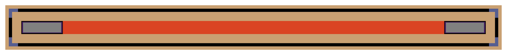
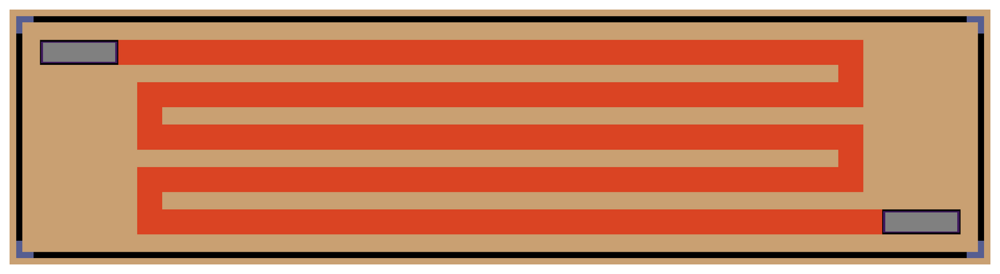

# What a resistor costs in area

If a resistance is just a length, how long is a real one, and is that a problem? This page puts
numbers on it.

From [Ohms per square](guide/ohms-per-square.md), for `sky130_fd_pr__res_high_po` drawn 1 µm
wide:

$$R(L) = 378.2448 + 317.2198\,L \qquad (L \text{ in µm})$$

Turn it around and you have a design procedure. To get $R$, draw

$$L = \frac{R - 378.2448}{317.2198}$$

## Three values, sized and simulated

| you want | $L$ from the formula | ngspice says |
|---:|---:|---:|
| 1 kΩ | 1.960036 µm | 1000.007 Ω |
| 10 kΩ | 30.331608 µm | 10 000.03 Ω |
| 100 kΩ | 314.046454 µm | 100 000.0 Ω |

```
--- B. sized to 1 k, 10 k, 100 k (ohms) ---
r_1k = 1.000007e+03
r_10k = 1.000003e+04
r_100k = 1.000000e+05
```

100 kΩ is a strip of polysilicon 314 micrometres long.

For scale, the smallest inverter in the SKY130 standard-cell library,
`sky130_fd_sc_hd__inv_1`, has `area : 3.7536` µm² in
`libs.ref/sky130_fd_sc_hd/lib/sky130_fd_sc_hd__tt_025C_1v80.lib`. Your 100 kΩ, at
314.046454 × 1 µm = 314.05 µm² of drawn poly, takes the silicon of **84 inverters**. One passive
component you would not think twice about on a breadboard costs as much floor space as a small
logic block.

It gets worse quickly. A 1 MΩ resistor in the same material at the same width needs

$$L = \frac{10^6 - 378.2448}{317.2198} = 3151.6\ \text{µm} = 3.15\ \text{mm}$$

which is longer than many whole dies. You don't fold a resistor like that; you redesign the
circuit so it doesn't need one.

## Width and area

One fact decides how every on-chip resistor gets drawn. Rearranging the resistance formula,

$$L \propto R\,W \quad\Longrightarrow\quad \text{area} = W L \propto R\,W^2$$

Area goes as the square of the width. Draw a resistor twice as wide for the same resistance and
you pay four times the silicon. Section D of the deck builds the same 100 kΩ at four more widths:

```
--- D. 100 k at four widths (ohms), and the area each one costs ---
r_w0p35 = 9.999975e+04
r_w0p69 = 1.000002e+05
r_w2 = 9.999982e+04
r_w5 = 1.000004e+05
```

| $W$ (µm) | $L$ (µm) | ngspice (Ω) | area $WL$ (µm²) | in `inv_1`s |
|---:|---:|---:|---:|---:|
| 0.35 | 101.9319 | 99 999.75 | **35.68** | 9.5 |
| 0.69 | 216.2792 | 100 000.2 | 149.23 | 39.8 |
| 1 | 314.046454 | 100 000.0 | 314.05 | 83.7 |
| 2 | 629.5313 | 99 999.82 | 1 259.06 | 335.4 |
| 5 | 1576.1560 | 100 000.4 | 7 880.78 | 2 099.5 |

Every row is the same value to five digits, and the bottom row is 221 times the area of the top
row. The square law predicts $(5/0.35)^2 = 204$; the rest comes from the fixed end resistance,
which shortens the required length slightly at the wide end.

The rule: draw a resistor at the narrowest width the design rules and your accuracy budget
allow. 0.35 µm is the narrowest `res_high_po` SKY130 permits. Widen it only on purpose, to get
better matching ([Matching and Pelgrom's law](guide/matching-beats-accuracy.md)) or to carry
current.

## Changing the material

Width and length are yours; the material comes from a menu. Here is the same 314.046454 × 1 µm
strip with four implants, from section C:

| model | value | Ω/□ (measured) |
|---|---:|---:|
| `res_generic_nd` (n+ diffusion) | 36.89775 kΩ | 120 |
| `res_generic_pd` (p+ diffusion) | 61.38915 kΩ | 197 |
| `res_high_po` | 100.0000 kΩ | 317.2198 |
| `res_xhigh_po` | 665.3872 kΩ | 2118.7619 |

`res_xhigh_po` gives 6.7 times as many ohms per micron. The 1 MΩ resistor shrinks from 3.15 mm to

$$L = \frac{10^6 - 34.2111}{2118.7619} = 472.0\ \text{µm}$$

That is still big, 472 µm² of poly at 1 µm wide, or 126 inverters, but it fits on a die.

> **Why 2118.7619 and not 2000.** The `res_xhigh_po` model card says `rsheet = 2000.0`. It also
> says `weff = {w-0.056}`: the strip comes out of the fab 56 nm narrower than you drew it,
> because the etch undercuts the edge. So at a drawn W = 1 µm the material is really 0.944 µm
> wide, and the resistance per micron of length is $2000 / 0.944 = 2118.6441\ \Omega$.
> [Lab 01](labs/lab-01-a-resistor-you-designed-overview.md) measures 2118.7619. That agrees to
> five digits, and the small remainder is the model's nonlinear body term. This is the first
> place in the course where what you drew and what you got differ by an amount you can calculate, and
> [Process corners](guide/the-value-you-drew-is-not-what-you-get.md) is about that gap.

## Folding a long resistor

A 314 µm × 1 µm strip does not fit anywhere sensible, so real layouts **fold** it: for example,
sixteen strips of 20 µm side by side, joined end to end by short metal straps, back and forth
like a ploughed field. The resistance is the same (squares are squares, and a corner counts as
roughly half a square), but now you also pay for:

- the metal straps and the contacts at every turn;
- the required spacing between neighbouring poly strips;
- a guard ring, if the resistor needs isolating from its neighbours;
- **dummy strips** at each end. These are extra resistors connected to nothing. Etching behaves
  differently at the edge of a pattern than in the middle, so a dummy makes the outermost real
  strip see the same surroundings as the inner ones, and the edge effect lands on a device
  nobody uses.

Drawn straight, a resistor is the rectangle the formula describes, a bar of poly with one contact
at each end:



Folded, it is the same bar walked back and forth, with a strap carrying the current around each
turn:



*This one has three passes, not the sixteen the 100 kΩ above would need; the figure shows the
shape, not the count. The red is the resistor body and the grey blocks at the ends are its
contacts. Each turn you add buys you height and costs you two corners.*

A folded 100 kΩ with guard ring and dummies typically occupies two to three times its 314 µm² of
drawn poly. Nobody publishes an exact multiplier, because it depends on the fold count and the
spacing rules, which is why AD104 has you draw one.

For a picture of the layers in "a strip of poly with two contacts", you can draw one in SiliWiz,
a browser layout tool that shows the cross-section as you draw. That is
[Lab 01, Part 9](labs/lab-01-a-resistor-you-designed-overview.md#part-9-optional-draw-a-resistor-in-siliwiz).

## How this shapes analog circuits

Every analog block you will read about is shaped by these numbers. Bias networks use ratios of
small resistors instead of one big one. Bandgap references use a handful of matched units rather
than one exact value. Filters that would want a megohm on a breadboard get built from switched
capacitors instead ([What to build instead of an inductor](guide/what-analog-builds-instead.md)).
None of that is tradition: it follows from 100 kΩ costing 84 inverters.

Next on the [Course path](README.md#course-path):
[Lab 01: A resistor you designed](labs/lab-01-a-resistor-you-designed-overview.md). After
that, [Capacitors on a chip](guide/a-capacitor-is-a-sandwich.md) asks the same question about
capacitors, and the area bill is much bigger.
