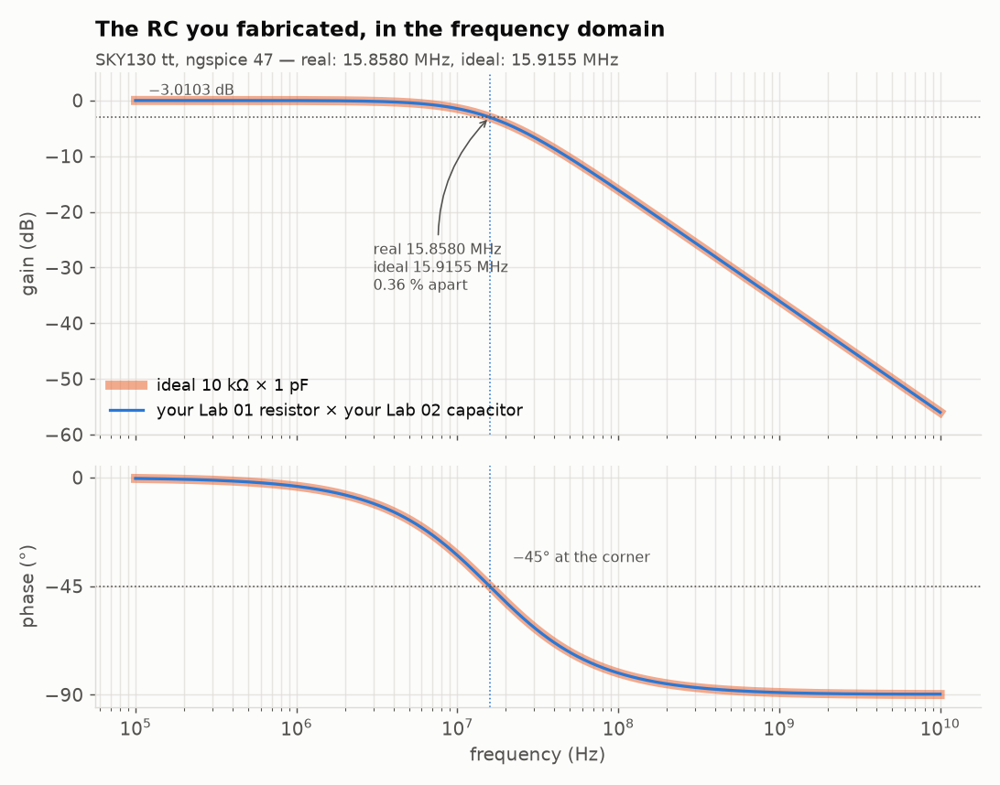
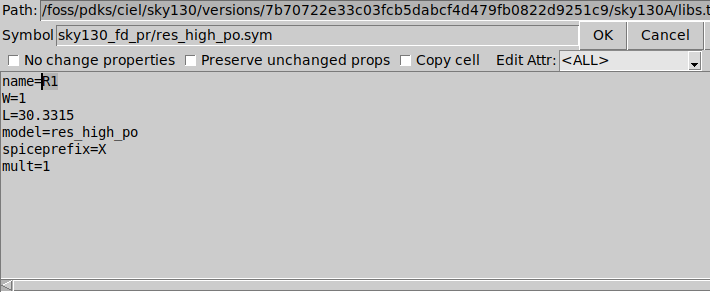

# Lab 03: A time constant in silicon

You designed a resistor in Lab 01 and a capacitor in Lab 02. In this lab you'll put them in one
circuit, measure its time constant, separate a measurement artefact from a real device effect,
and find the cheapest split between $R$ and $C$ for a target $\tau$. Then you'll measure the same
RC in the frequency domain and see why chips count clock ticks instead of charging capacitors.

Package: [`labs/lab-03-a-time-constant-in-silicon/`](https://github.com/uoftasic/ad102/tree/main/labs/lab-03-a-time-constant-in-silicon)

## Before you start

- Finish [Lab 01](labs/lab-01-a-resistor-you-designed-overview.md) and
  [Lab 02](labs/lab-02-how-big-is-a-picofarad-overview.md). This lab uses the resistor
  ($L = 30.3315$ µm) and capacitor ($s = 22.1965$ µm) you sized there, and Lab 01's
  `solutions/README.md`.
- Read [What to build instead of an inductor](guide/what-analog-builds-instead.md).
- Open a terminal in the workbench and go to the lab folder:

  ```bash
  cd /foss/designs/modules/ad102/labs/lab-03-a-time-constant-in-silicon
  ```

  The decks need no environment setup. Only the XSchem window in the optional Part 8 needs the
  noVNC desktop and `$PDK` set to `sky130A` (Lab 01, Part 1).

Parts 1 to 7 are required. Part 8, under Going further at the end, is optional.

Time: about 2 hours, not counting the optional part. `make` runs two ngspice decks,
each silent while the SKY130 model cards load (about a minute each on the pinned image; see
[Warnings and delays](reference/ngspice-decks-that-run.md#lab-03)).

A resistor charging a capacitor from a step follows

$$v(t) = V_f\left(1 - e^{-t/RC}\right) \qquad \tau = RC$$

At $t = \tau$ the output has covered $1 - e^{-1} = 0.632120$ of its journey. So the measurement
is: step the input, find the moment the output crosses 63.2 % of its final value, and that time
is $\tau$ by definition. Every `meas` in this lab is one line doing exactly that.

## Part 1: Measure two time constants you can predict

Does a `meas` on a simple RC return the $\tau$ you predict?

Section A of `spice/rc.spice` is [ECE334](https://uoftasic.com/ece334-docs/)'s lab-1 RC deck,
unchanged: a 1 kΩ/2 kΩ divider with 0.7 pF on the tap, driven by a 1.8 V pulse. It is the version
of this circuit a UofT student has most likely already run. Section B is an ideal 10 kΩ and an ideal
1 pF, so its $\tau$ is 10 ns by construction.

1. Predict both time constants. In section A the capacitor sees the Thévenin resistance, not 1 kΩ:

   $$R_{\text{th}} = 1\text{k} \parallel 2\text{k} = 666.67\ \Omega
   \qquad \tau = 666.67 \times 0.7\,\text{pF} = 466.67\ \text{ps}$$

   and it charges toward $1.8 \times \tfrac{2}{3} = 1.2$ V.

2. Run the lab:

   ```bash
   make
   ```

   It ends in `FAIL`, on area; you fix that in Part 6. Leave the output in your terminal.

3. Read the raw `meas` lines near the top of the output, not the checker's table:

   ```
   t_ece334            =  1.47167e-09
   t_ideal             =  1.10050e-08
   v_ece334            =  1.20000e+00
   ```

4. The step happens at $t = 1$ ns, so subtract 1 ns from each time and compare with your
   predictions.

**You should see:** the final value is 1.2000 V, as Thévenin says. But the ECE334 circuit took
471.67 ps against a predicted 466.67, and the ideal RC took 10.0050 ns against a predicted
10.0000. Both are five picoseconds late: the same 5 ps on two circuits whose time constants
differ by a factor of twenty-one.

An error that does not scale with the thing being measured is not a property of that thing. The
pulse source in the deck is

```
Va ai 0 PULSE(0 1.8 1n 10p 10p 200n 400n)
```

Where do the 5 ps come from?

<details>
<summary>Answer</summary>

The rise time is 10 ps, so the step is really a ramp, and a first-order system responds as though
the step arrived at the ramp's midpoint. Half of 10 ps is 5 ps. `check_rc.py` subtracts 1.005 ns,
and then both circuits read exactly right:

```
  A  ECE334 deck: 1k/2k divider + 0.7 pF, ideal         466.6700 ps    466.6700 ps
  B  ideal 10 kohm + ideal 1 pF                          10.0000 ns     10.0000 ns
```

Telling a **measurement artefact** from a **device effect** is most of what analog verification
is. The clue here was that the error did not scale.

</details>

## Part 2: Swap in your own resistor and capacitor

Does the RC still give 10 ns when the parts are the ones you designed?

Sections C, D and E of the deck replace the ideal 10 kΩ with your Lab 01 resistor ($L = 30.3315$ µm), then the
ideal 1 pF with your Lab 02 capacitor ($s = 22.1965$ µm), then both.

1. Predict all three. You designed both devices to hit their targets to better than one part in
   ten thousand, so you should predict 10.0000 ns three times.

2. Find lines C, D and E in the checker's table.

3. Find section H in the raw output, the block headed
   `--- H. the resistor's own capacitance to substrate`. It leaves each resistor's far end
   unconnected and measures what current the source still has to supply, which gives the
   resistor's own capacitance to the substrate.

**You should see:**

```
  C  YOUR Lab 01 resistor + ideal 1 pF                   10.0361 ns
  D  ideal 10 kohm + YOUR Lab 02 capacitor               10.0000 ns
  E  both of yours, no ideal parts anywhere              10.0362 ns
```

```
--- H. the resistor's own capacitance to substrate (farads) ---
cpar_10k = 7.233642e-15
cpar_1m = 9.527787e-14
```

The capacitor makes no difference: swapping a real MIM plate for an ideal 1 pF changes nothing to
five figures. The resistor adds 36.1 ps, and it adds the same 36.1 ps whether the capacitor next
to it is real or ideal. The checker fits both strips from section H and prints, below its
table:

```
    fitting both strips: 0.1994 fF per um of 1 um-wide poly, plus 1.1870 fF of ends.
```

You'll use that 0.1994 fF per µm in Parts 5 and 6.

How does section H account for the 36 ps?

<details>
<summary>Answer</summary>

A 30 µm strip of poly is a 7.2 fF capacitor, whether you wanted one or not. For a distributed RC
line, half of that adds to the time constant:
$10\,\text{k}\Omega \times 7.234\,\text{fF}/2 = 36.2$ ps, against the 36.1 ps you measured. So
your resistor is also a capacitor. At 10 kΩ it costs you 0.36 %; Part 5 finds the size where you
can no longer ignore it.

</details>

## Part 3: Sizing without Labs 01 and 02

What would this circuit have done if you had sized it from the model cards alone?

Section F sizes the identical circuit with the two naive rules: length straight from the sheet
resistance, and area straight from the capacitance density.

1. Lab 01's end resistance was worth 3.7 % on a 10 kΩ resistor, and Lab 02's fringe was worth
   1.5 % on a picofarad. Predict the timing error of the naive circuit.

2. Find line F and the two summary lines below the table.

**You should see:**

```
  F  the same circuit sized without Labs 01 and 02       10.5647 ns

  designing with Labs 01 and 02 : +0.36 % from the 10.0000 ns you asked for
  designing without them        : +5.65 %
```

Together with the resistor's own 0.36 % from Part 2, the two errors come to 5.65 % of timing
error in one circuit. Neither shows up as a warning or
in DRC, and neither averages out across a wafer: every chip gets the same 5.65 %. That is the
difference between a **tolerance**, which you budget for, and a **mistake**, which you don't know
about.

## Part 4: Temperature

How much does the same silicon drift between −40 °C and +125 °C?

The deck runs section E again at −40 °C and +125 °C. Nothing about the layout changes.

1. Predict the direction before you look. Lab 01's `solutions/README.md` gave `res_high_po`'s
   temperature coefficient as `tc1 = 0.514e-3`.

2. Find the two "E again" lines and the span line.

**You should see:**

```
     E again at -40 C                                     9.7849 ns
     E again at +125 C                                   10.6544 ns

  and the SAME silicon over -40 C to +125 C spans 8.66 %
```

You spent this lab chasing a 5.65 % sizing error, and temperature alone is worth 8.66 % over an
industrial range. The MIM capacitor's model card has `tc1 = 0`. What does that tell you about
where the drift comes from, and about using an on-chip RC as a clock?

<details>
<summary>Answer</summary>

The MIM capacitor contributes almost none of the drift, so nearly all of it comes from the
resistor. An on-chip RC is a fine way to make a filter corner that is allowed to wander, and a bad
way to make a clock.

</details>

## Part 5: A one-microsecond RC

What happens to a real RC when the resistor gets big?

Section G of the deck builds 1 µs twice: once with an ideal 1 MΩ, and once with a real one,
471.98 µm of `res_xhigh_po` sized with your Lab 01 numbers. The checker's table calls them G and
H.

1. Using the 0.1994 fF per µm from Part 2, predict the error before you look.

2. Find lines G and H in the checker's table (not section H of the raw output, which was Part
   2's), and the lines below the table about the microsecond.

**You should see:**

```
  G  ideal 1 Mohm + ideal 1 pF                          999.9950 ns
  H  real 1 Mohm of xhigh poly + your 1 pF             1049.9550 ns

  the microsecond ran 49.96 ns long.
    a 471.98 um strip of poly carries 95.278 fF to the substrate, and half of it
    adds to the time constant: R*Cpar/2 = 47.64 ns, which is 95 % of what you measured.
```

The microsecond is 5 % long, and no capacitor was mis-sized. The strip that makes the megohm
carries 95 fF of its own, a tenth of the capacitor it is charging.

A millisecond needs a thousand times this $RC$, say 100 MΩ and 10 pF. Could you build it?

<details>
<summary>Answer</summary>

No. At 1 µm wide, 100 MΩ of `res_xhigh_po` is 47,197 µm of poly: 4.7 centimetres, folded into a
serpentine, carrying about 9.4 pF to the substrate by itself. The resistor's parasitic is now the
same size as the capacitor it was supposed to charge, and no value of either fixes that.

You cannot build a millisecond from an RC on a chip. What chips do instead is count: an
oscillator makes a short, repeatable interval, and a digital counter multiplies it. That is why
[DD103](https://uoftasic.com/dd103/)'s elevator controller measures its door dwell in clock
ticks. It is one of the cleanest examples anywhere of a digital answer to an analog question,
and this measurement explains why the question comes up.

</details>

## Part 6: Your own 20 ns time constant

How small can you make a 20 ns RC?

`spice/my_rc.spice` has one resistor length and one capacitor side. Build a 20.0 ns time
constant, within 1 %, in under 400 µm² of drawn area.

The file ships with 2 kΩ and 10 pF. That is a fine 20 ns, but it costs 4981.84 µm², twelve times
the budget, so the check in Part 1 failed on area, not on timing:

```
  resistor  L =   5.1124 um at W = 1 um   ->       5.11 um^2
  capacitor s =  70.5459 um square       ->    4976.72 um^2
  total drawn area                         ->    4981.84 um^2   (budget 400)   FAIL
  tau = 20.0020 ns   target 20.0000 ns   (+0.01 %)   PASS
```

1. Write down the two sizing formulas you already have, and the area:

   $$R = 378.2448 + 317.2198\,L \qquad
   C[\text{fF}] = 2.000000\,s^2 + 0.659991\,s - 0.017742$$

   Area is $L + s^2$.

2. Work out which way to move $R$ and $C$ to reduce the area while keeping $RC = 20$ ns, and find
   the optimum.

3. Check the resistor's own parasitic, 0.1994 fF per micrometre of length plus 1.187 fF of ends
   (Part 2). As the capacitor gets smaller, the resistor's parasitic becomes a visible fraction
   of it and $\tau$ runs long: half of the parasitic adds to the capacitor, so
   $\tau \approx R\,(C + C_{\text{par}}/2)$. Shrink the intended capacitor to pay for it.

4. In `spice/my_rc.spice`, change the resistor's `L=` and the capacitor's `W=` and `L=` (keep
   the plate square), as plain microns with no `u` suffix, and re-run:

   ```bash
   make mine check
   ```

**You should see:** both the area line and the `tau` line marked `PASS`, then

```
PASS -- every number matches the reference run.
```

## Part 7: The same RC in the frequency domain

Does the corner frequency from an `.ac` analysis agree with the $\tau$ you measured?

So far you have measured the RC with a stopwatch: step the input and time the output. AD101
taught the other way: drive the input at every frequency and find where the output stops keeping
up. The two answers are tied together:

$$f_{-3\text{dB}} = \frac{1}{2\pi\tau}$$

`spice/bode.spice` uses the same two devices as section E, and also simulates the ideal
10 kΩ × 1 pF you would have drawn in AD101.

1. Take your $\tau$ from Part 2, 10.0362 ns, and predict the corner frequency.

2. Run the frequency-domain deck and draw its plot:

   ```bash
   make bode
   ```

   It loads the same model library as the other decks, so expect the same short wait. The
   Makefile banner says "~2 s" and mentions a pre-flattened library; the 2026.08 image doesn't
   ship that library, so ignore the banner's time.

**You should see:**

```
f3db_real           =  1.58580e+07
f3db_ideal          =  1.59155e+07
ph_real             =  -7.85359e-01
--- decade of roll-off: the real filter, dB at 10x the corner ---
g_10x               =  -2.00426e+01
  wrote results/ad102-rc-bode.png
```

That PNG is your own copy of the figure below, drawn from your own `results/bode.txt`.

Your prediction:

$$\frac{1}{2\pi \times 10.0362\ \text{ns}} = 15.858088\ \text{MHz}$$

and `.ac` measured 15.8580 MHz: six significant figures, from two analyses that share nothing but
the two device lines. Two independent measurements agreeing is the only evidence you get that a
deck is right, and checking one against the other costs nothing. Make it a habit: with any RC you
have three numbers, $R$, $C$ and $\tau$, and any two give you the third. If they disagree, one of
your decks is wrong and you have found out cheaply.

The other two lines confirm the shape of a first-order filter:

- `ph_real = -7.85359e-01` is in **radians**: −44.998°, the textbook −45° at the corner.
- `g_10x = -2.00426e+01` is −20.0426 dB one decade past the corner, the −20 dB/decade slope you
  read off Bode plots in AD101, now measured on a resistor and capacitor you designed.



How far is your fabricated corner from the ideal one, and how far would the Part 3 design have
been?

<details>
<summary>Answer</summary>

0.36 %. Labs 01 and 02 (the end resistance, the perimeter capacitance, the sizing you got wrong on
the first try) bought you a filter whose corner is that close to the ideal one you drew on paper.
The same filter designed without those two labs, in Part 3, lands 5.65 % out, sixteen times
worse.

</details>

## Finishing

You're done when `make mine check`, run on the resistor length and capacitor side you chose in
Part 6, prints `PASS -- every number matches the reference run.` Your design doesn't have to
match anyone else's: it passes when $\tau$ is within 1 % of 20 ns and the area is under
400 µm². "Matches the reference run" is about the `rc.spice` numbers the checker also compares.

A transient analysis of a linear circuit has no randomness in it, so on the pinned image
(ngspice-47, `sky130A`, `tt` corner) your numbers match the ones on this page.

Question: in your Part 6 design, compare the resistor's area with the capacitor's. Why should they
come out roughly equal?

<details>
<summary>Answer</summary>

Resistor area is roughly $R/317.22$ µm² and capacitor area roughly $C[\text{fF}]/2$ µm², and
$C = \tau/R$, so the total has the form $aR + b/R$. Whenever cost has that form, the minimum is
where the two halves of the bill are the same size. The reference answer in
[`solutions/README.md`](https://github.com/uoftasic/ad102/blob/main/labs/lab-03-a-time-constant-in-silicon/solutions/README.md)
has 176.36 µm² of resistor and 164.43 µm² of capacitor, and works through why it isn't exactly
50/50.

</details>

After yours passes, read the same `solutions/README.md` for one good answer, why the two halves
of the area bill come out equal, and the millisecond that cannot be built.

Submit: nothing for this lab.

## Going further (optional)

Part 8 is not in the time estimate, and no later part of AD102 needs it. What to do next on the
Course path is the last line of this page.

### Part 8 (optional): The same circuit in XSchem

So far you have typed device lines and ngspice has believed you. The rest of the analog track
describes circuits the other way: you **draw** them, and the tool writes the device lines for you.

`xschem/rc.sch` is section E of `spice/rc.spice`, drawn: the same resistor (30.3315 µm of high-sheet
poly), the same capacitor (a 22.1965 µm square of MIM), and the same pulse.


The **SKY130** badge in the top right shows which parts catalogue XSchem loaded. If yours says
**IHP**, stop and redo the PDK steps in
[Lab 01, Part 1](labs/lab-01-a-resistor-you-designed-overview.md#part-1-load-the-course).
The resistor symbol prints `R=9.999k` beside itself, because the SKY130 symbols compute the
resistance live from the `W` and `L` you give them. The capacitor shows `C=1.002p`.

1. Turn the drawing into a netlist. This works without the desktop:

   ```bash
   make netlist
   ```

   ```
   == netlisting xschem/rc.sch
      wrote xschem/simulation/rc.spice
   XR1 out in 0 sky130_fd_pr__res_high_po W=1 L=30.3315 mult=1
   XC1 out 0 sky130_fd_pr__cap_mim_m3_1 W=22.1965 L=22.1965 MF=1
   ```

   Those are the two device lines XSchem wrote from the picture, and they are the same two lines
   section E of `spice/rc.spice` has by hand. A schematic is a netlist you can see.

2. Simulate what XSchem wrote:

   ```bash
   cd xschem/simulation && ngspice -b rc.spice; cd ../..
   ```

   It loads the same model library, so there is the same short wait. Among the output is a
   warning you can ignore, because the schematic asks for a plot that batch mode cannot draw:

   ```
   Warning: command 'plot' is not available during batch simulation, ignored!
       You may use Gnuplot instead.
   ```

   `meas` still ran, and its answer is the line below the warning.

3. If you have the noVNC desktop up, open the schematic:

   ```bash
   echo $PDK        # must say sky130A
   make edit
   ```

   XSchem opens on the drawing. Click **Netlist & Simulate** in the top left of the canvas, and
   the waveform appears in a window.

4. Double-click the resistor symbol:

   

   That is your device line, as a form. Change `L`, press **OK**, and watch the printed `R=` on
   the symbol change. Re-simulate and watch $\tau$ follow it.

   Notice what the dialog does not have: a unit. `L=30.3315` is thirty micrometres.
   `L=30.3315u` would be thirty millionths of a micrometre, and the schematic editor will accept
   it just as happily as a text deck would.

**You should see:** after step 2,

```
t_real              =  1.10412e-08
```

Subtract the same 1.005 ns offset from Part 1 and that is $\tau = 10.0362$ ns, the same five
figures as section E. The picture and the deck agree, because they are the same circuit.

[AD103](https://uoftasic.com/ad103/) is entirely XSchem (you'll draw a diode, then a transistor, then a CMOS inverter), and it assumes you
have already seen a schematic turn into a netlist, as you just did here.

Next on the [Course path](README.md#course-path): read
[Process corners](guide/the-value-you-drew-is-not-what-you-get.md) and
[Matching and Pelgrom's law](guide/matching-beats-accuracy.md), then do
[Lab 04: Two resistors that disagree](labs/lab-04-two-resistors-that-disagree-overview.md).
